## Connecting Your Device to Power

The OSSM comes with bespoke a 24V 4A DC power supply - this is what will power your machine during play.

Here's how to connect your OSSM to power:

1. Plug the socket plug of the power supply cord into a wall socket
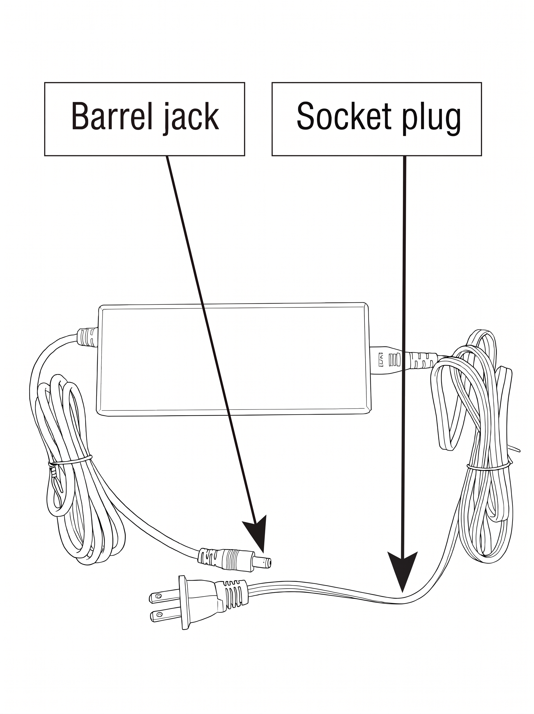
2. Plug the barrel jack end of the power supply into the barrel jack port on your OSSM board
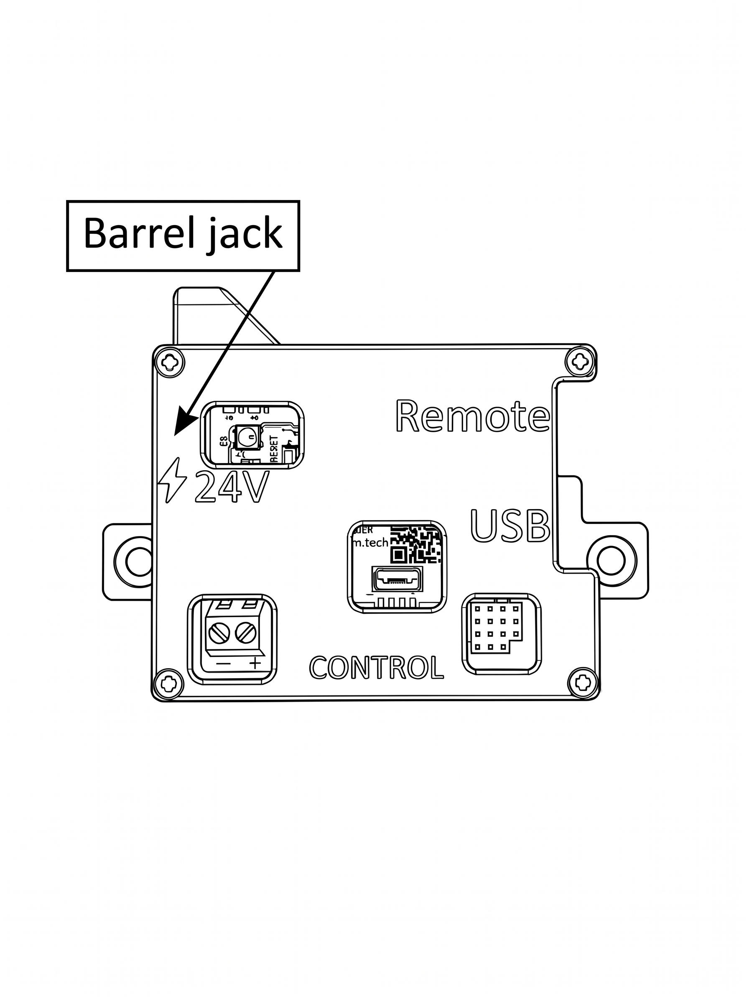
1. Check that the board's LED lights up, and let the device home
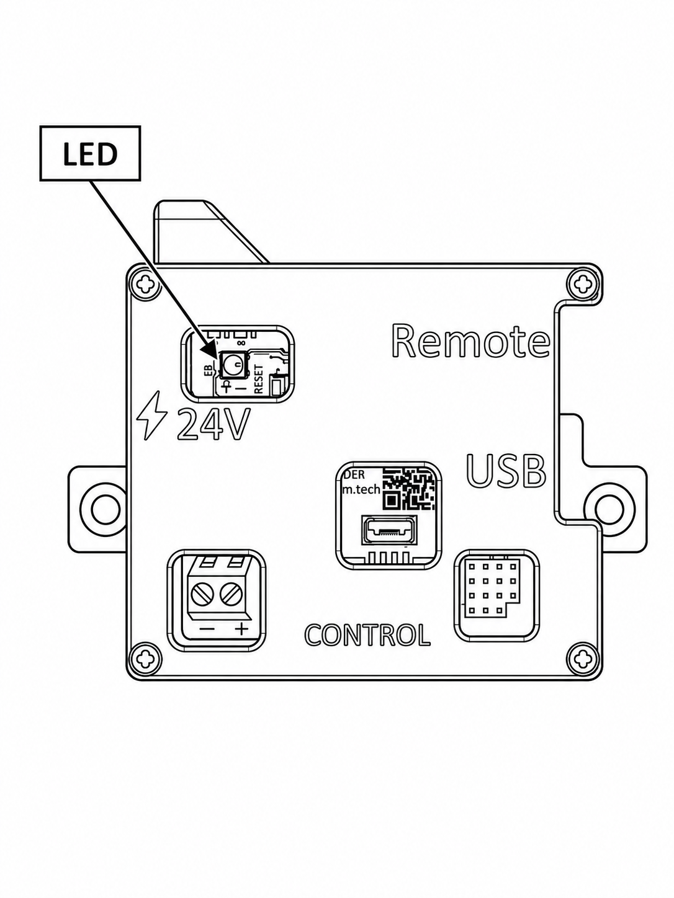

<Callout type="success" title={"Your OSSM is receiving power!"} />

<Callout type="info" title={"Homing is the process by which your OSSM gauges the distance between both end points of the linear rail. To home, the device slowly moves the rail back and forth for a short period of time."} />

<Callout type="warning" title={"We caution against using third party power supplies as their use may short the OSSM board, thus rendering the OSSM unusable, or provide insufficient operating power."} />

## Controlling Your OSSM

You can control your OSSM using one of three different remote types:

  1. Wired Remote 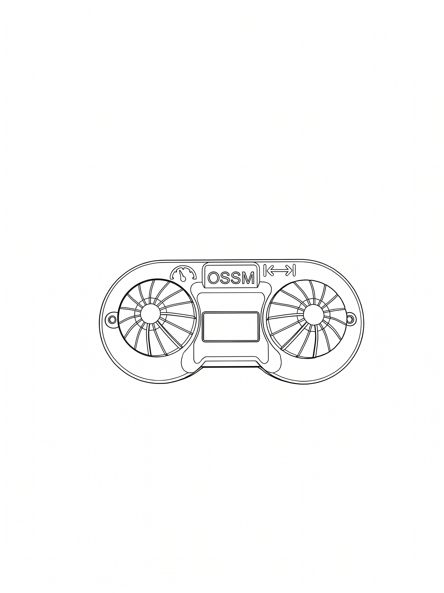
  2. Wireless Remote (RADR) 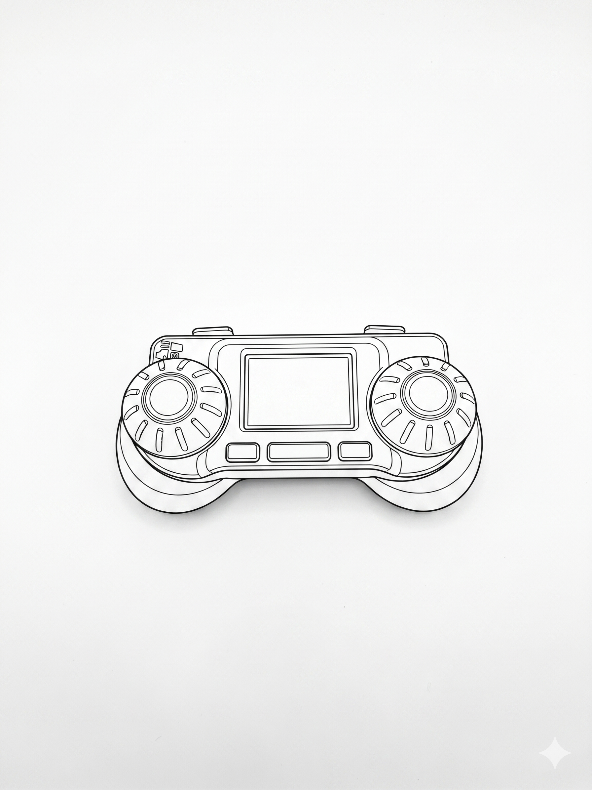
  3. Web Controller 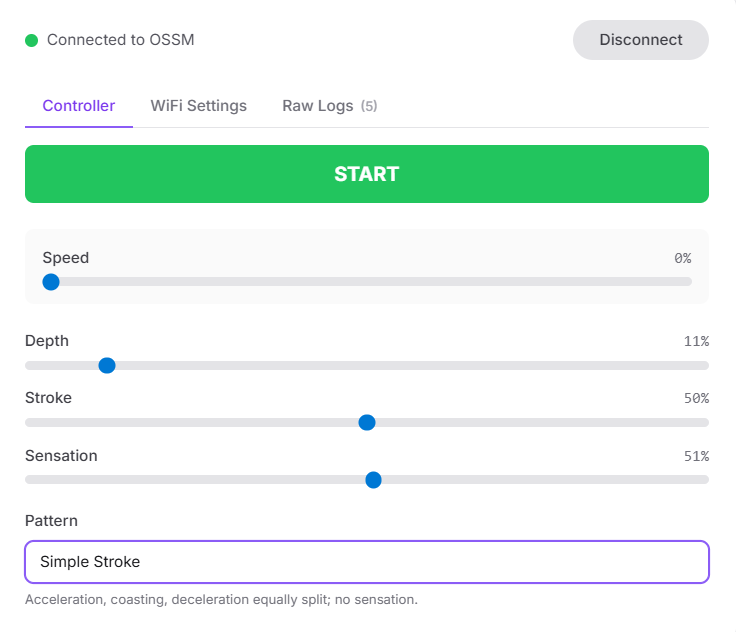

Please note that the OSSM will home when:

1. You connect your OSSM to power
2. You select Simple Penetration or Stroke Engine modes

### Wired Remote

#### Connecting your Wired Remote to the OSSM

To connect your Wired Remote to the OSSM:

1. Connect the Remote to your OSSM board via Ethernet cable
2. Connect your OSSM to a power source

<Callout type="success" title={"The Remote screen will flash the R+D logo and present you with an on-screen menu!"} />

#### Using the Wired Remote

The Wired Remote has a left and a right knob.

**Right knob**

- Scrolls the menu
- Adjusts stroke length.  You can press and hold the right knob button during play to stop the machine and return to the Remote's main menu
- Acts as a menu selection button
- Acts as a back button outside of Simple Penetration and Stroke Engine modes

<Callout type="info" title={"When in Stroke Engine mode double-click the right knob to access pattern selection."} />

**Left knob**

- Adjusts stroke speed
  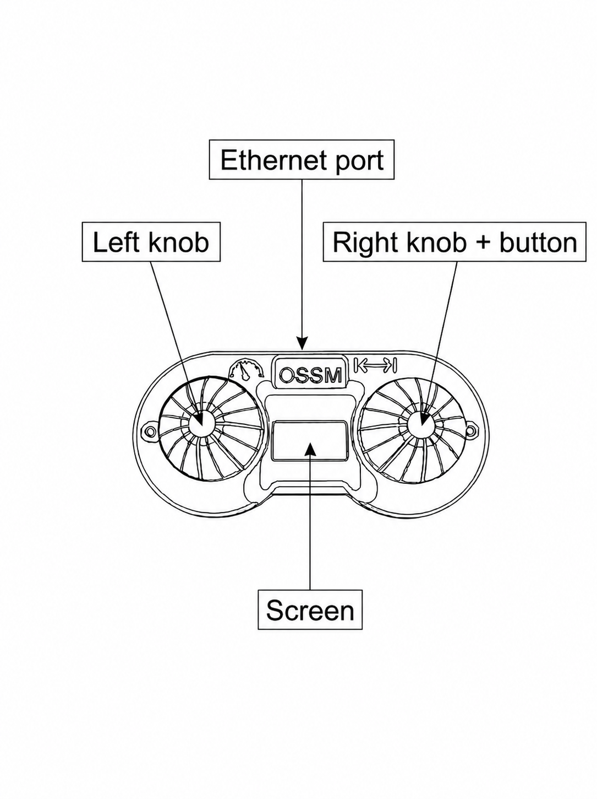

### Wireless Remote

Let's start with some orientation. In comparison to the Wired Remote, the Wireless Remote has more buttons (for fun physical interactivity!) In this doc we'll be directing you to press certain buttons. Take a second to review the photo below to orient yourself with the device's physical controls and how we refer to them.
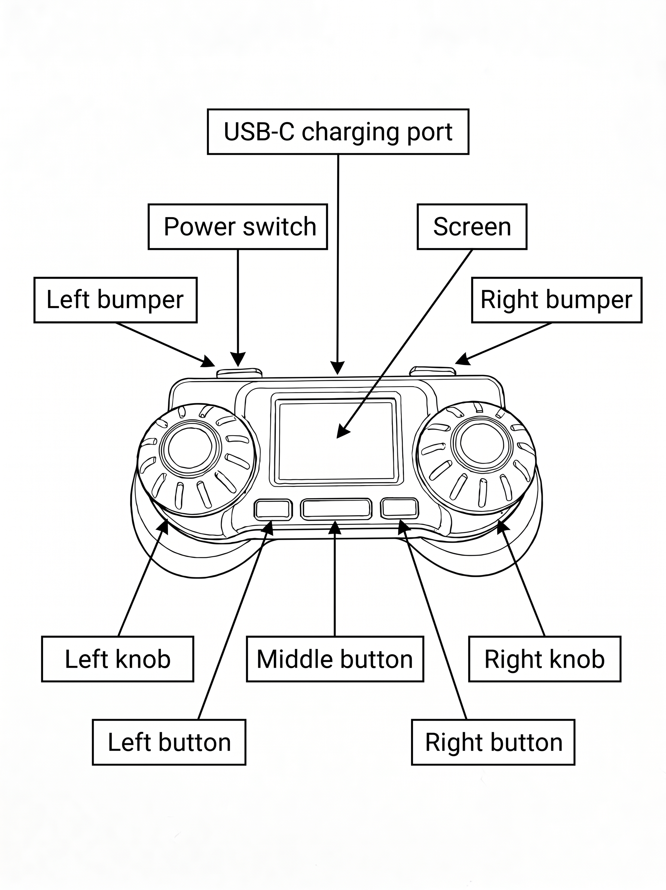

#### Connecting your Wireless Remote to the OSSM

The Wireless Remote connects to your OSSM via Bluetooth. To connect your Wireless Remote to your OSSM:

1. Connect your OSSM to power and allow it to home
2. Turn on the Wireless Remote via the power switch
3. The Wireless Remote will detect your OSSM. Use the right button to select your OSSM 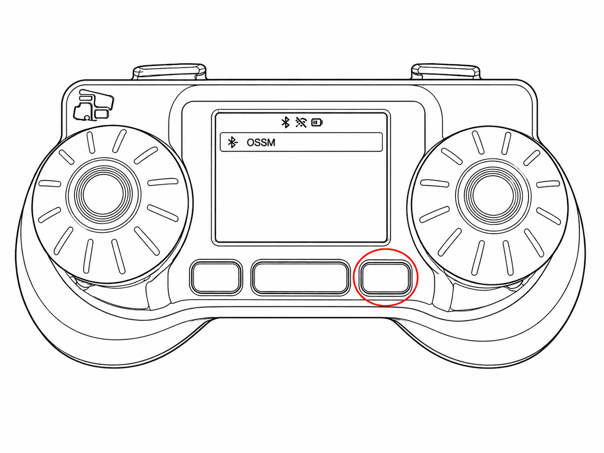

<Callout type="success" title={"You are now at the Simple Stroke screen and can start controlling your OSSM with the Wireless Remote!"} />

#### Using your Wireless Remote

Here you can use the right knob to adjust depth (stroke length) and the left to adjust speed. You can press the middle button to pause the device instantaneously during play.

The right button acts as a selection button, while the left button acts as a back button.

To explore play patterns, click the rightmost button and select whichever pattern suits your fancy. As with Simple Stroke, you can adjust your Speed, Depth, Sensation, and Stroke settings during play. To alternate between Depth, Sensation, and Stroke selections use the left and right bumpers.

<Callout type="info" title={"Sensation affects how Patterns function. When you hover over a Pattern option, a small blurb will appear below that Pattern text that explains how Sensation adjustments affect the pattern's activity."} />

#### Status Indicators

The Wireless Remote has a Bluetooth connectivity indicator, a WiFi connectivity indicator, and a battery life indicator. You can find them displayed at the top centre of the device screen.

  

<Callout type="error" title={"If you are unable to connect your Wireless Remote to your OSSM, see our troubleshooting guide here."} />

<Callout type="error" title={"If you are unable to connect your Wireless Remote to WiFi, see our troubleshooting guide here."} />

### Web Controller

The [Web Controller](/ossm/tools/web-controller) allows you to control your OSSM without a physical remote. It connects to your OSSM over Bluetooth from your browser, so your OSSM does not need WiFi to use it. To connect, power on your OSSM and let it home, open the Web Controller, select "Click to Connect", choose your OSSM in the browser's device list, and click "Pair". The Web Controller cannot change your OSSM's WiFi settings; to connect your OSSM to WiFi, see [Connecting Your Device to WiFi](#connecting-your-device-to-wifi). The interface for the Web Controller looks like this:

  

<Callout type="warning" title={"The Web Controller is not supported on iOS devices, nor is it supported on Firefox or Safari browsers."} />

### Stroke Engine, Patterns, & Sensation

Patterns provide you with a more exciting, spontaneous way to play with your OSSM. Each pattern has unique, pre-set motion parameters that govern how the OSSM interacts with you during use.

- Wired Remote accesses patterns through the "Stroke Engine" selection

- Wireless Remote accesses patterns through the "Patterns" selection

- Web Controller accesses patterns through the "Pattern" dropdown

Below is a list of the patterns that come with the device and a description of what they do:

<Callout type="info" title={"The \"X\" factor of each pattern is determined by your Sensation settings. Sensation settings can be adjusted via the Wireless Remote and the Web Controller, but cannot be adjusted via the Wired Remote."} />

1. Simple Stroke - Moves in and out smoothly according to your speed and depth settings. Sensation has no effect.
2. Teasing or Pounding - The machine either thrusts in very slowly and out quickly, or in very quickly and out slowly, as determined by Sensation.
3. Robo Stroke - Adjusts how quickly the device accelerates. Sensation determines acceleration speed.
4. Half'n'Half - Every second stroke is half your selected depth. Sensation affects whether the in our out movement is the faster movement.
5. Deeper - Starts with shallow thrusts and gradually increases to full length thrusts. Sensation affects how short or long the device takes to reach max thrust depth.
6. Stop'n'Go -A series of strokes with intermittent pauses. Sensation controls the length of the pause.
7. Insist - Tiny rapid pulses. Sensation affects whether the feeling of stroke thrust comes from the base or tip of the rail.

## Connecting Your Device to WiFi

Connecting your OSSM to WiFi enables it to receive firmware updates as they are released. This ensures your device is always up to date!

<Callout type="warning" title={"The OSSM is compatible only with a 2.4GHz network."} />

The Web Controller does not have WiFi settings. Use one of the options below instead.

### WiFi Setup Option #1 (Wired Remote)

While the **Wi-Fi Setup** screen is open on the Wired Remote, the OSSM broadcasts its own temporary setup network called **OSSM Setup**.

1. Connect your OSSM to power and let it home
2. On the Wired Remote, turn the right knob to highlight "Wi-Fi Setup" in the menu, then press the right knob to select it
3. Keep the Wi-Fi Setup screen open until you finish. Pressing the right knob closes the screen and turns off the setup network
4. Using your phone camera, scan the QR code that appears on the remote screen, or open the WiFi settings on your phone or computer and connect to the open network named "OSSM Setup" (no password)
5. When the setup page opens, select "Configure WiFi". If the page does not open by itself, go to `http://192.168.4.1` in your browser
6. Select your WiFi network (this will auto-fill the SSID info), enter your WiFi password, and click save 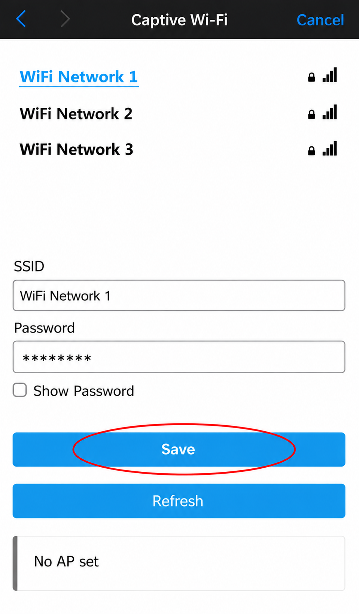
7. Wait for the OSSM to connect. Once connected, the remote returns to the menu, and opening "Wi-Fi Setup" again shows "You are now connected to WiFi!"

<Callout type="success" title={"Yay! Your OSSM is connected to WiFi."} />

<Callout type="info" title={"Changing networks"}>

To connect to a different network, open **Wi-Fi Setup** while the OSSM is connected and press and hold the right knob. The OSSM forgets the saved network and restarts. Then repeat the steps above.

If you select **Pairing** or **Update** while the OSSM is not connected to WiFi, the OSSM shows the Wi-Fi Setup screen instead. Connect the OSSM to WiFi with the steps above, then select **Pairing** or **Update** again.

</Callout>

### WiFi Setup Option #2 (Wireless Remote)

The Wireless Remote's own "WiFi Settings" menu and its "RADR Setup" network connect the remote itself to WiFi, not the OSSM. Once the remote is connected to WiFi, it shares that network with your OSSM over Bluetooth whenever they connect and the OSSM is not already on WiFi.

1. Connect your OSSM to power and let it home
2. Connect your Wireless Remote to your WiFi network (see [Connecting to WiFi](/radr/guides/user-guide/connecting-to-wifi) for the full guide):
   1. Press the left button to open the Wireless Remote's main menu, then select "Settings" 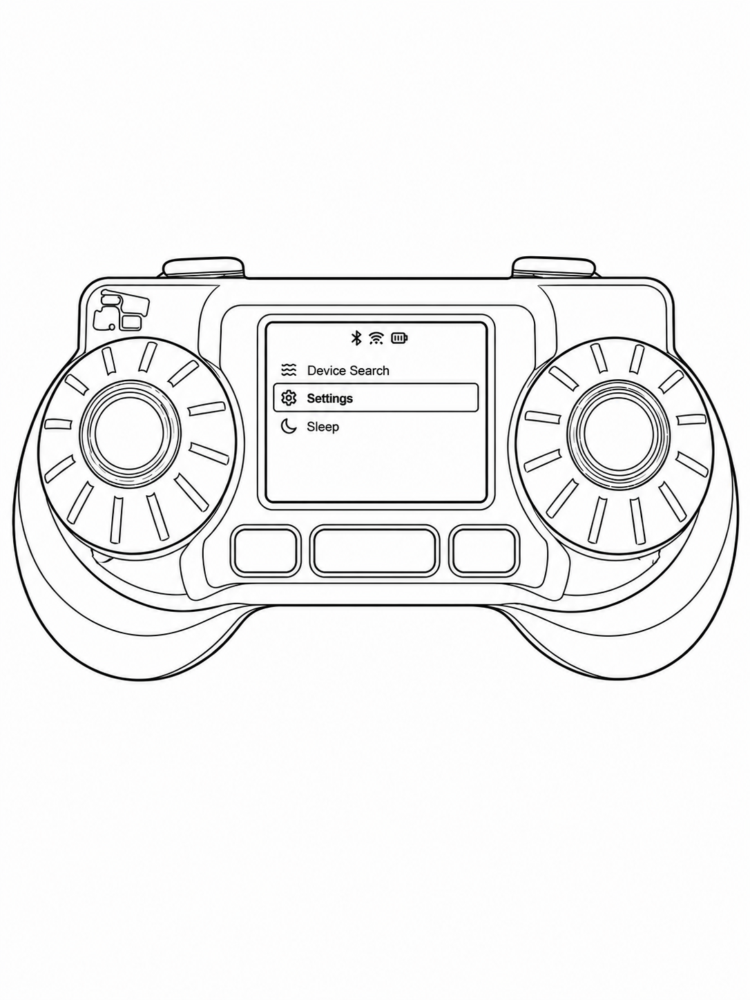
   2. Select "WiFi Settings" 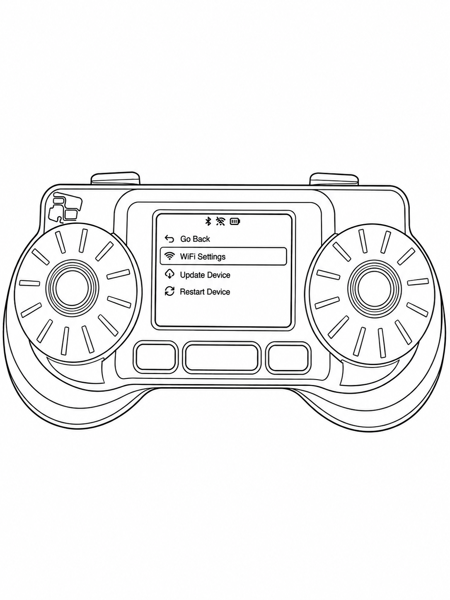
   3. Using your phone camera, scan the QR code that appears on the remote screen 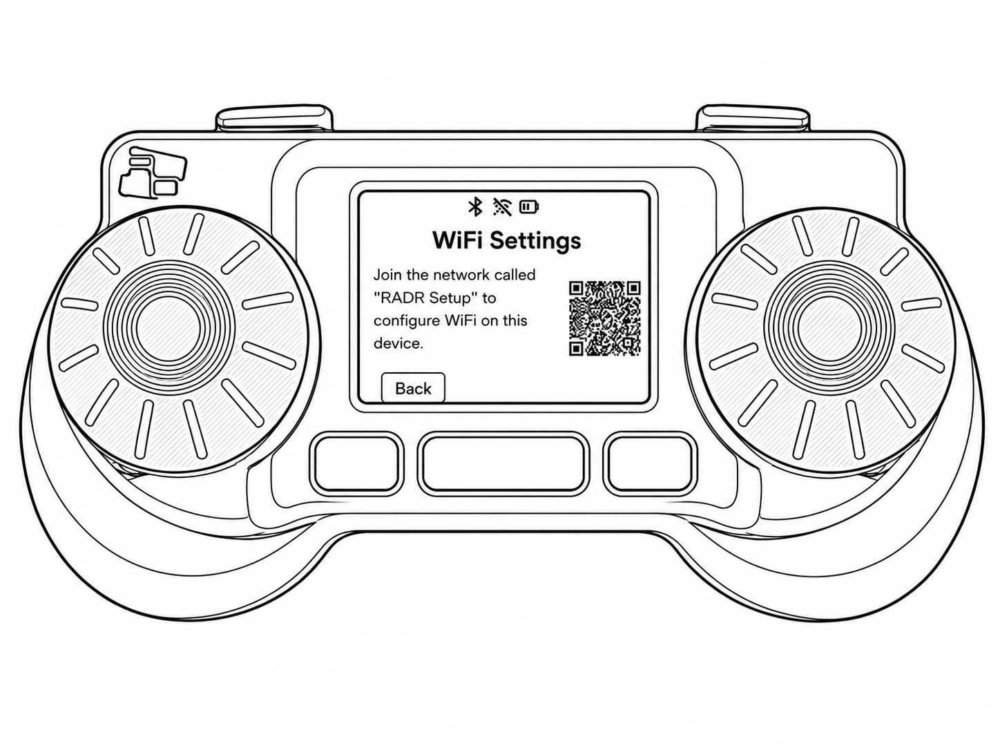
   4. On your phone or computer, connect to the WiFi network named "RADR Setup" 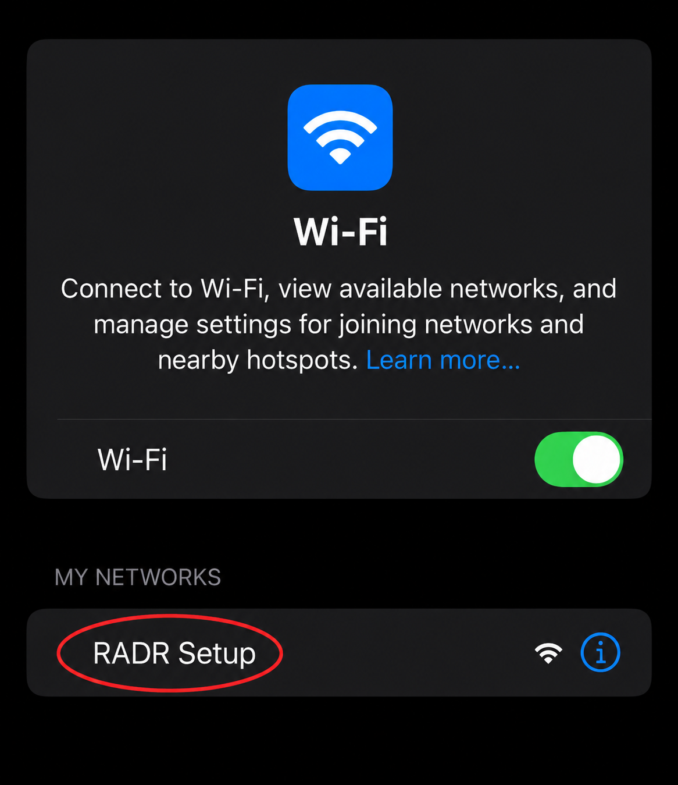
   5. Select "Configure WiFi" 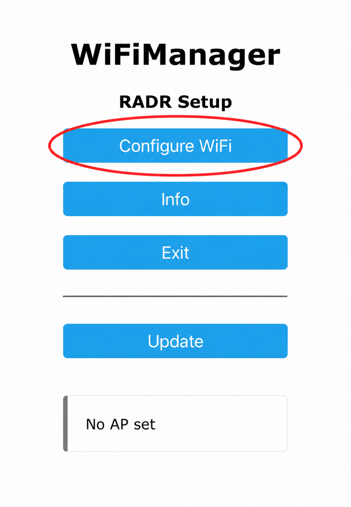
   6. Select your WiFi network (this will auto-fill the SSID info), enter your WiFi password, and click save 
3. [Connect your Wireless Remote to your OSSM](#connecting-your-wireless-remote-to-the-ossm). The remote sends its WiFi network name and password to the OSSM when they connect
4. Wait about 30 seconds for the OSSM to join your network

<Callout type="success" title={"Yay! Your OSSM is connected to WiFi."} />

<Callout type="info" title={"WiFi Required"}>

If you select **Pairing** or **Update OSSM** from the Wireless Remote's OSSM menu while the OSSM is not on WiFi, the remote shows **WiFi Required**. Press **Share Wi-Fi**, wait about 30 seconds, then try again. If the OSSM still does not connect, use Option #1.

</Callout>

### WiFi Setup Option #3 (R+D Dashboard)

If you are pairing your OSSM with your R+D Dashboard account using Chrome or Edge, the Dashboard can send your WiFi details to the OSSM over Bluetooth:

1. Connect your OSSM to power and let it home
2. In the R+D Dashboard, select "Pair an OSSM", then open the "Auto (Bluetooth)" tab
3. Select "Scan for OSSM" and choose your OSSM in the browser's device list
4. Choose your WiFi network or enter it manually, then select "Pair & Send WiFi"

If your OSSM does not appear in the Bluetooth device list, use Option #1.

# Pre-play Safety Checklist

The OSSM is a powerful device and we want to make sure you have the tools to use it safely!

Before you use your OSSM for play, make sure to follow these steps:

1. Erect your OSSM and place it in a position that will be comfortable for you during play
2. Place a filled sandbag over the base of the machine for stability
3. If using a Wired Remote, connect the remote to the machine via Ethernet cable
4. Attach your suction cup or Vac-u-Lock toy
5. Connect your OSSM to a power source
6. Set all Remote settings (Depth, Sensation, Stroke) to zero
7. Get comfortable and slowly adjust settings until you feel confident using the device

<Callout type="success" title={"You have completed the OSSM Pre-play Safety Checklist!"} />

