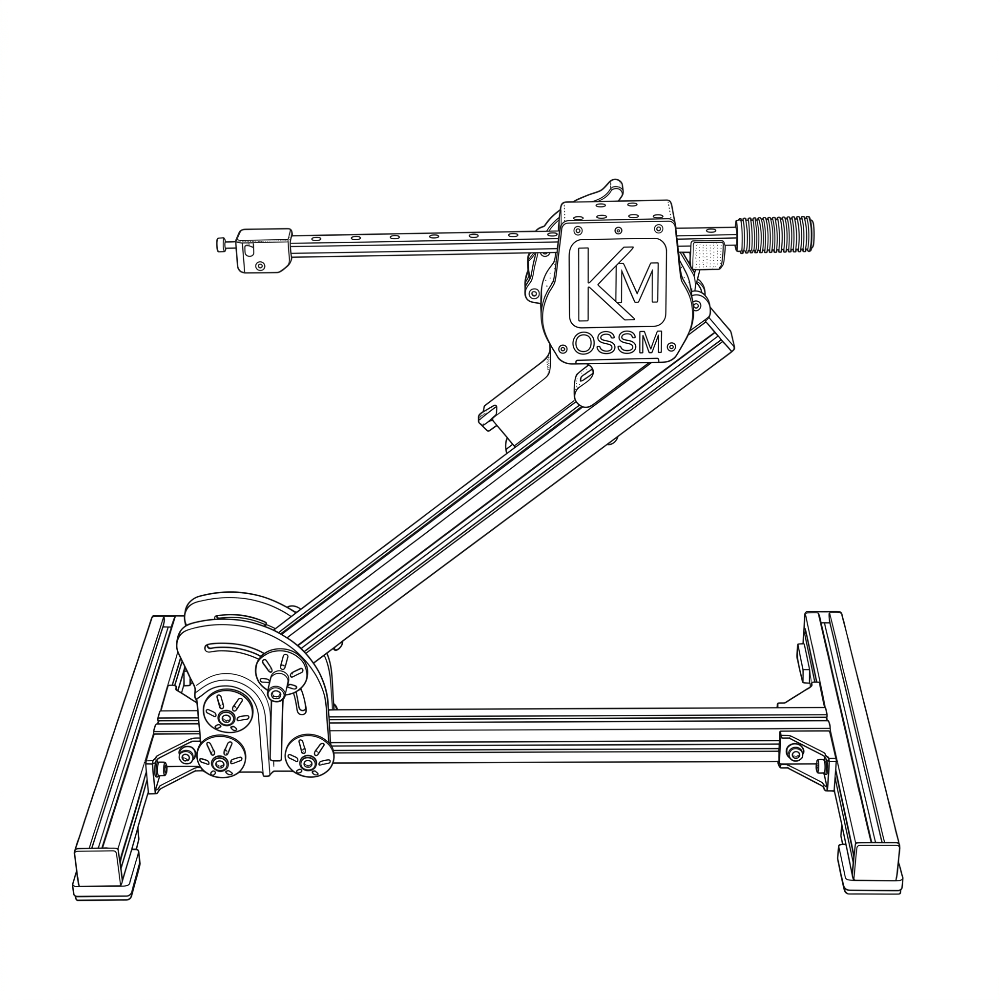

But enough about that! You've probably just received your OSSM and are excited to put it to good use. Let's get to unboxing.

## Need help?

If you scanned the QR code on your OSSM's **Get Help** screen, start here:

<Cards>
  <Card title="How to use your OSSM" href="/ossm/how-to-use">
    Power, homing, remotes, patterns, Wi-Fi and the pre-play safety checklist.
  </Card>
  <Card title="OSSM tools" href="/ossm/tools">
    Web flasher, web controller, Funscript player and the Gold Motor Programming Tool.
  </Card>
  <Card title="Gold Motor Programming Tool" href="/ossm/tools/gold-motor-programming">
    For "Homing took too long" with a motor that hisses, crawls or does not move.
  </Card>
  <Card title="Assembly and wiring" href="https://ohai.researchanddesire.com/ossm/cable-harnesses">
    Motor control harness pinout and the OSSM bill of materials.
  </Card>
</Cards>

Still stuck? Email [support@researchanddesire.com](mailto:support@researchanddesire.com) with your firmware version (shown at the bottom left of the start-up screen), a photo of your power supply label and a short video of the problem, or ask the community on [Discord](https://discord.gg/DHTuY2AZYJ).
