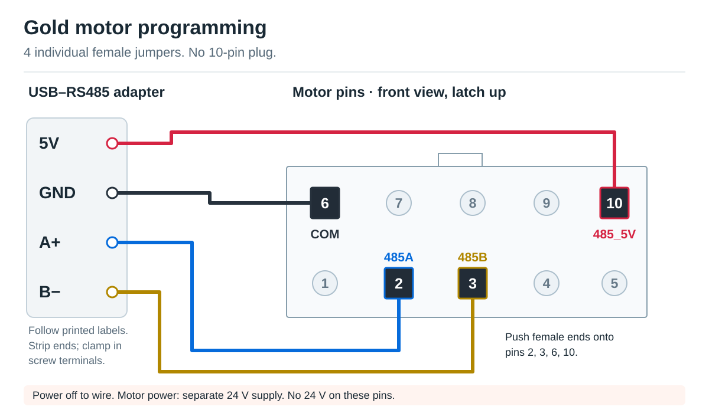

import { GoldMotorControl } from "@repo/device-tools/gold-motor-control";

Restore the standard OSSM settings on a Gold Motor (57AIM series). This changes motor settings, not firmware.

## What you need

A Gold Motor, [CERRXIAN USB–RS485 adapter (B09JMT9D59)](https://www.amazon.com/dp/B09JMT9D59), four female Arduino jumper wires, wire cutters/strippers, a small screwdriver, the motor's 24 V power supply, and a desktop computer running Chrome or Edge.

## Connect the wires

<Callout type="warn" title="Power off before wiring">

Unplug USB and motor power. Keep all other motor signal connections disconnected.

</Callout>

1. Cut one end off each jumper and strip the wire. Clamp the stripped ends in the adapter's labelled screw terminals.
2. Push the female ends directly onto the motor's header pins as shown below. **Do not use a 10-pin plug.**

| Adapter terminal | Motor pin | Motor signal |
| --- | --- | --- |
| 5V | 10 | 485_5V |
| GND | 6 | COM |
| A+ | 2 | 485A |
| B− | 3 | 485B |

Leave the other pins unconnected. Check the four connections before applying power.

**Motor power is separate:** connect the motor's 24 V supply to its power terminals. Never connect 24 V to the adapter or these header pins.

## Program the motor

1. Keep the motor shaft clear. Plug the adapter into the computer and switch on motor power.
2. In the tool below, click **Connect to Motor** and select the adapter's serial port. Click **Read Registers** and confirm numeric values appear without errors.
3. Click **Reset fields to OSSM Standard**. Leave Advanced Settings closed, then click **Write Settings** once. Wait for all three write passes and the readback to finish.
4. Check the standard values: **0x0B = 800**, **0x18 = 600**, **0x05 = 3000**, **0x07 = 3000**, and **0x09 = 1**.
5. Click **Disconnect**, unplug USB, and switch off motor power. Reconnect both, connect in the tool, and click **Read Registers** to confirm the settings saved. Disconnect both power sources before removing the jumpers.

<GoldMotorControl />
